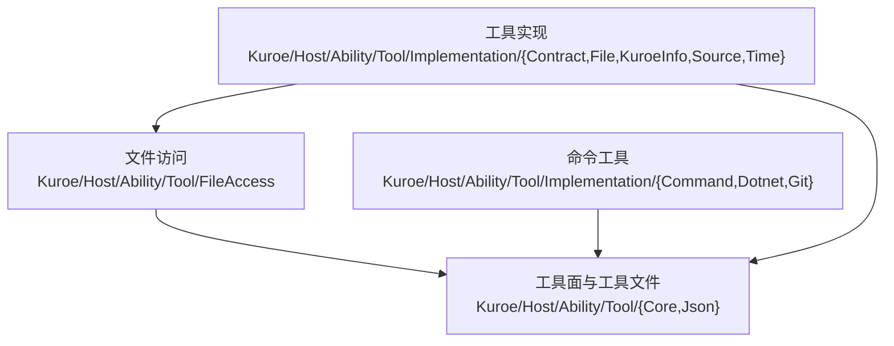

# 工具

上层结构见[执行能力](../index.md)。

| 子域 | 项目 | 文件 |
| --- | --- | --- |
| 工具面与工具文件 | `Kuroe.Host.Ability.Tool` | [kuroe-host-ability-tool](kuroe-host-ability-tool.md) |
| 工具面与工具文件 | `Kuroe.Host.Ability.Tool.Json` | [kuroe-host-ability-tool-json](kuroe-host-ability-tool-json.md) |
| 文件访问 | `Kuroe.Host.Ability.Tool.FileAccess.Shared` | [kuroe-host-ability-tool-file-access-shared](kuroe-host-ability-tool-file-access-shared.md) |
| 文件访问 | `Kuroe.Host.Ability.Tool.FileAccess` | [kuroe-host-ability-tool-file-access](kuroe-host-ability-tool-file-access.md) |
| 命令工具 | `Kuroe.Host.Ability.Tool.Implementation.Command.Shared` | [kuroe-host-ability-tool-implementation-command-shared](kuroe-host-ability-tool-implementation-command-shared.md) |
| 命令工具 | `Kuroe.Host.Ability.Tool.Implementation.Command` | [kuroe-host-ability-tool-implementation-command](kuroe-host-ability-tool-implementation-command.md) |
| 命令工具 | `Kuroe.Host.Ability.Tool.Implementation.Command.Json` | [kuroe-host-ability-tool-implementation-command-json](kuroe-host-ability-tool-implementation-command-json.md) |
| 命令工具 | `Kuroe.Host.Ability.Tool.Implementation.Dotnet` | [kuroe-host-ability-tool-implementation-dotnet](kuroe-host-ability-tool-implementation-dotnet.md) |
| 命令工具 | `Kuroe.Host.Ability.Tool.Implementation.Git` | [kuroe-host-ability-tool-implementation-git](kuroe-host-ability-tool-implementation-git.md) |
| 工具实现 | `Kuroe.Host.Ability.Tool.Implementation.Contract` | [kuroe-host-ability-tool-implementation-contract](kuroe-host-ability-tool-implementation-contract.md) |
| 工具实现 | `Kuroe.Host.Ability.Tool.Implementation.File` | [kuroe-host-ability-tool-implementation-file](kuroe-host-ability-tool-implementation-file.md) |
| 工具实现 | `Kuroe.Host.Ability.Tool.Implementation.KuroeInfo` | [kuroe-host-ability-tool-implementation-kuroe-info](kuroe-host-ability-tool-implementation-kuroe-info.md) |
| 工具实现 | `Kuroe.Host.Ability.Tool.Implementation.Source` | [kuroe-host-ability-tool-implementation-source](kuroe-host-ability-tool-implementation-source.md) |
| 工具实现 | `Kuroe.Host.Ability.Tool.Implementation.Time` | [kuroe-host-ability-tool-implementation-time](kuroe-host-ability-tool-implementation-time.md) |