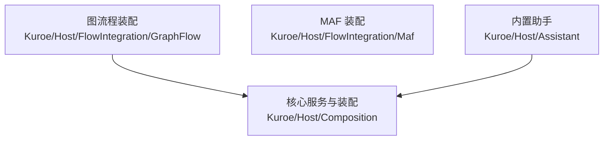

# 宿主装配

上层结构见[项目结构](../index.md)。

| 子域 | 项目 | 文件 |
| --- | --- | --- |
| 核心服务与装配 | `Kuroe.Host.Composition` | [kuroe-host-composition](composition/kuroe-host-composition.md) |
| 图流程装配 | `Kuroe.Host.FlowIntegration.GraphFlow` | [kuroe-host-flow-integration-graph-flow](graph-flow/kuroe-host-flow-integration-graph-flow.md) |
| MAF 装配 | `Kuroe.Host.FlowIntegration.Maf` | [kuroe-host-flow-integration-maf](maf/kuroe-host-flow-integration-maf.md) |
| 内置助手 | `Kuroe.Host.Assistant` | [kuroe-host-assistant](assistant/kuroe-host-assistant.md) |