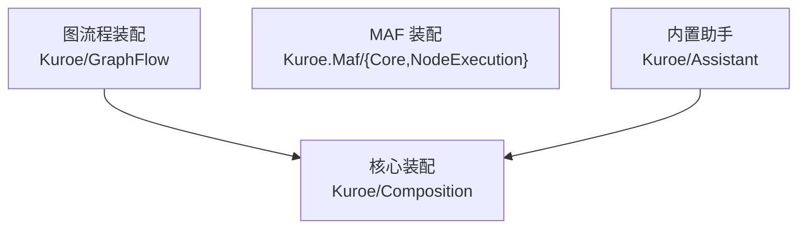

# 宿主装配

上层结构见[项目结构](../index.md)。

| 子域 | 项目 | 文件 |
| --- | --- | --- |
| 核心装配 | `Kuroe.Composition` | [kuroe-composition](composition/kuroe-composition.md) |
| 图流程装配 | `Kuroe.GraphFlow` | [kuroe-graph-flow](graph-flow/kuroe-graph-flow.md) |
| MAF 装配 | `Kuroe.Maf` | [kuroe-maf](maf/kuroe-maf.md) |
| MAF 装配 | `Kuroe.Maf.NodeExecution` | [kuroe-maf-node-execution](maf/kuroe-maf-node-execution.md) |
| 内置助手 | `Kuroe.Assistant` | [kuroe-assistant](assistant/kuroe-assistant.md) |