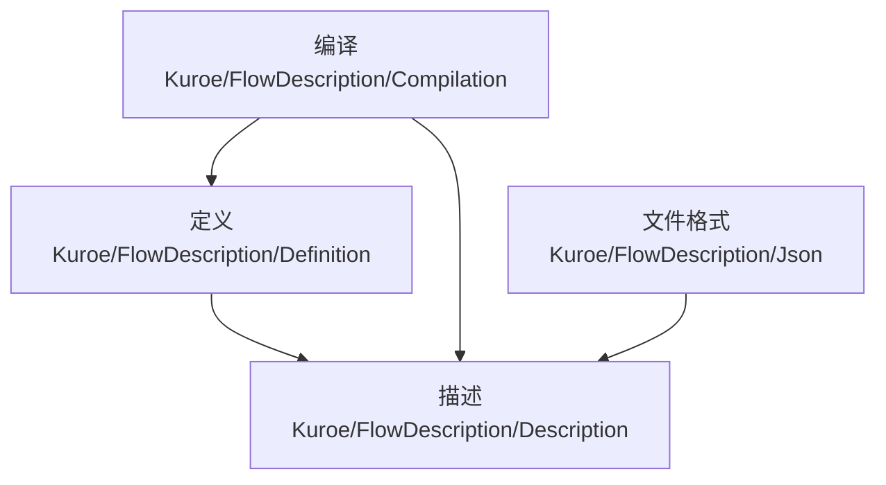

# 流程描述

上层结构见[项目结构](../index.md)。

| 子域 | 项目 | 文件 |
| --- | --- | --- |
| 描述 | `Kuroe.FlowDescription.Description.Shared` | [kuroe-flow-description-description-shared](flow-description/kuroe-flow-description-description-shared.md) |
| 定义 | `Kuroe.FlowDescription.Definition.Shared` | [kuroe-flow-description-definition-shared](flow-description/kuroe-flow-description-definition-shared.md) |
| 编译 | `Kuroe.FlowDescription.Compilation.Shared` | [kuroe-flow-description-compilation-shared](flow-description/kuroe-flow-description-compilation-shared.md) |
| 编译 | `Kuroe.FlowDescription.Compilation` | [kuroe-flow-description-compilation](flow-description/kuroe-flow-description-compilation.md) |
| 文件格式 | `Kuroe.FlowDescription.Json.Shared` | [kuroe-flow-description-json-shared](flow-description/kuroe-flow-description-json-shared.md) |
| 文件格式 | `Kuroe.FlowDescription.Json` | [kuroe-flow-description-json](flow-description/kuroe-flow-description-json.md) |