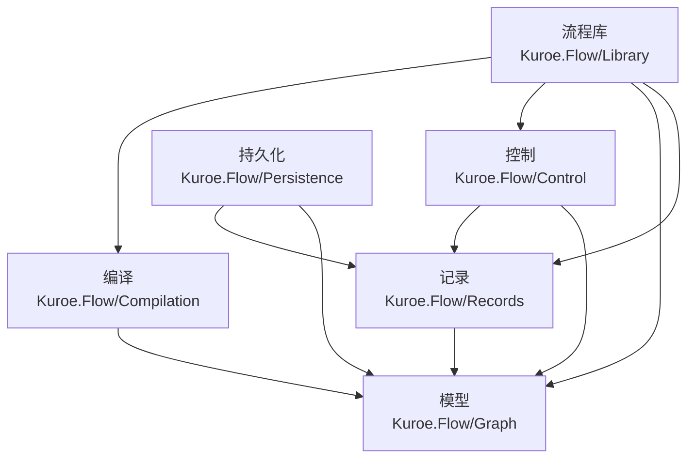

# 图流程

上层结构见[流程实现](../index.md)。

| 子域 | 项目 | 文件 |
| --- | --- | --- |
| 记录 | `Kuroe.Flow.Records.Shared` | [kuroe-flow-records-shared](kuroe-flow-records-shared.md) |
| 模型 | `Kuroe.Flow.Graph.Shared` | [kuroe-flow-graph-shared](kuroe-flow-graph-shared.md) |
| 编译 | `Kuroe.Flow.Compilation` | [kuroe-flow-compilation](kuroe-flow-compilation.md) |
| 控制 | `Kuroe.Flow.Control` | [kuroe-flow-control](kuroe-flow-control.md) |
| 流程库 | `Kuroe.Flow.Library` | [kuroe-flow-library](kuroe-flow-library.md) |
| 流程库 | `Kuroe.Flow.Library.Files` | [kuroe-flow-library-files](kuroe-flow-library-files.md) |
| 持久化 | `Kuroe.Flow.Persistence.Serialization.Graph` | [kuroe-flow-persistence-serialization-graph](kuroe-flow-persistence-serialization-graph.md) |