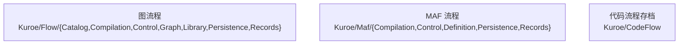

# 流程实现

上层结构见[项目结构](../index.md)。

| 子域 | 项目 | 文件 |
| --- | --- | --- |
| 图流程 |  | [graph](graph/index.md) |
| MAF 流程 |  | [maf](maf/index.md) |
| 代码流程存档 | `Kuroe.CodeFlow.Records.Shared` | [kuroe-code-flow-records-shared](code/kuroe-code-flow-records-shared.md) |
| 代码流程存档 | `Kuroe.CodeFlow.Persistence` | [kuroe-code-flow-persistence](code/kuroe-code-flow-persistence.md) |