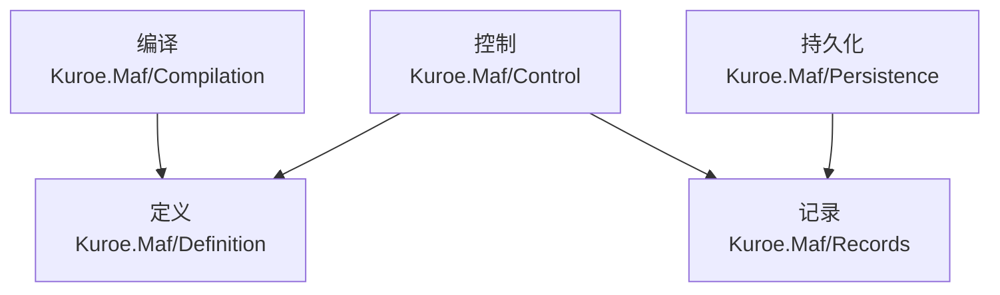

# MAF 流程

上层结构见[流程实现](../index.md)。

| 子域 | 项目 | 文件 |
| --- | --- | --- |
| 定义 | `Kuroe.Maf.Definition` | [kuroe-maf-definition](kuroe-maf-definition.md) |
| 编译 | `Kuroe.Maf.Compilation.Shared` | [kuroe-maf-compilation-shared](kuroe-maf-compilation-shared.md) |
| 编译 | `Kuroe.Maf.Compilation` | [kuroe-maf-compilation](kuroe-maf-compilation.md) |
| 控制 | `Kuroe.Maf.Control` | [kuroe-maf-control](kuroe-maf-control.md) |
| 记录 | `Kuroe.Maf.Records.Shared` | [kuroe-maf-records-shared](kuroe-maf-records-shared.md) |
| 持久化 | `Kuroe.Maf.Persistence` | [kuroe-maf-persistence](kuroe-maf-persistence.md) |