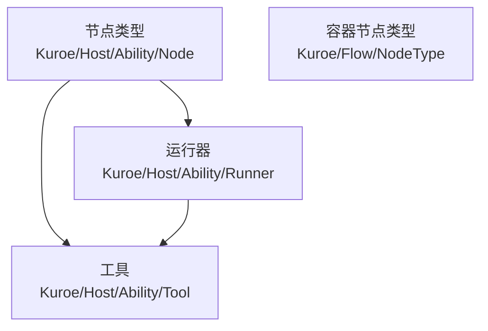

# 执行能力

上层结构见[宿主](../index.md)。

| 子域 | 项目 | 文件 |
| --- | --- | --- |
| 节点类型 | `Kuroe.Host.Ability.Node.Llm` | [kuroe-host-ability-node-llm](node/kuroe-host-ability-node-llm.md) |
| 节点类型 | `Kuroe.Host.Ability.Node.Command` | [kuroe-host-ability-node-command](node/kuroe-host-ability-node-command.md) |
| 节点类型 | `Kuroe.Host.Ability.Node.File` | [kuroe-host-ability-node-file](node/kuroe-host-ability-node-file.md) |
| 节点类型 | `Kuroe.Host.Ability.Node.Input` | [kuroe-host-ability-node-input](node/kuroe-host-ability-node-input.md) |
| 节点类型 | `Kuroe.Host.Ability.Node.Approval` | [kuroe-host-ability-node-approval](node/kuroe-host-ability-node-approval.md) |
| 运行器 | `Kuroe.Host.Ability.Runner.Shared` | [kuroe-host-ability-runner-shared](runner/kuroe-host-ability-runner-shared.md) |
| 运行器 | `Kuroe.Host.Ability.Runner.Llm` | [kuroe-host-ability-runner-llm](runner/kuroe-host-ability-runner-llm.md) |
| 运行器 | `Kuroe.Host.Ability.Runner.Command` | [kuroe-host-ability-runner-command](runner/kuroe-host-ability-runner-command.md) |
| 运行器 | `Kuroe.Host.Ability.Runner.File` | [kuroe-host-ability-runner-file](runner/kuroe-host-ability-runner-file.md) |
| 运行器 | `Kuroe.Host.Ability.Runner.Input` | [kuroe-host-ability-runner-input](runner/kuroe-host-ability-runner-input.md) |
| 运行器 | `Kuroe.Host.Ability.Runner.Approval` | [kuroe-host-ability-runner-approval](runner/kuroe-host-ability-runner-approval.md) |
| 工具 |  | [tool](tool/index.md) |
| 容器节点类型 | `Kuroe.Flow.NodeType.Container` | [kuroe-flow-node-type-container](container/kuroe-flow-node-type-container.md) |