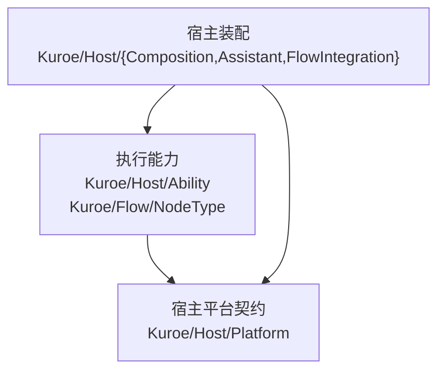

# 宿主

上层结构见[项目结构](../index.md)。

| 子域 | 项目 | 文件 |
| --- | --- | --- |
| 执行能力 |  | [ability](ability/index.md) |
| 宿主装配 |  | [assembly](assembly/index.md) |
| 宿主平台契约 | `Kuroe.Host.Platform` | [kuroe-host-platform](platform/kuroe-host-platform.md) |