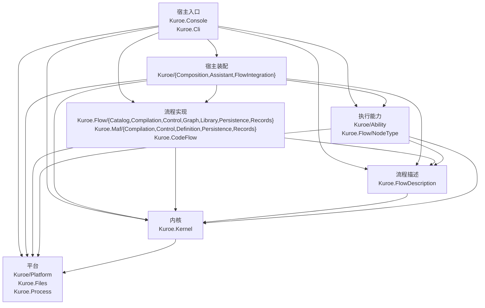

# 项目结构

| 域 | 文件 |
| --- | --- |
| 宿主入口 | [entry](entry/index.md) |
| 宿主装配 | [assembly](assembly/index.md) |
| 流程实现 | [flow](flow/index.md) |
| 流程描述 | [description](description/index.md) |
| 执行能力 | [ability](ability/index.md) |
| 内核 | [kernel](kernel/index.md) |
| 平台 | [platform](platform/index.md) |