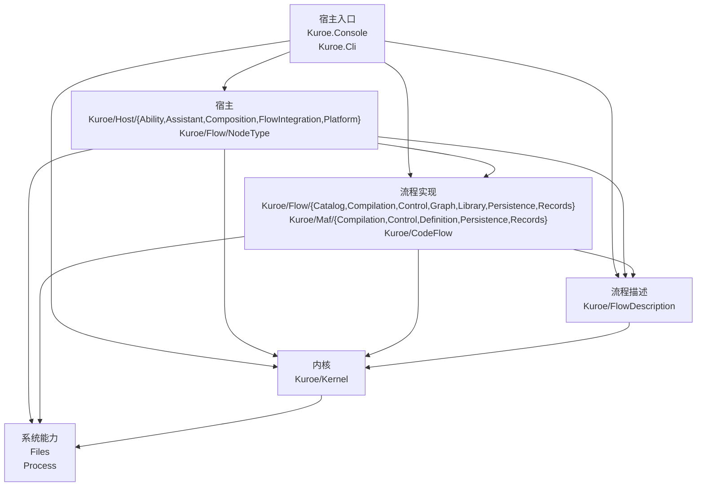

# 项目结构

| 域 | 文件 |
| --- | --- |
| 宿主入口 | [entry](entry/index.md) |
| 宿主 | [host](host/index.md) |
| 流程实现 | [flow](flow/index.md) |
| 流程描述 | [description](description/index.md) |
| 内核 | [kernel](kernel/index.md) |
| 系统能力 | [system](system/index.md) |