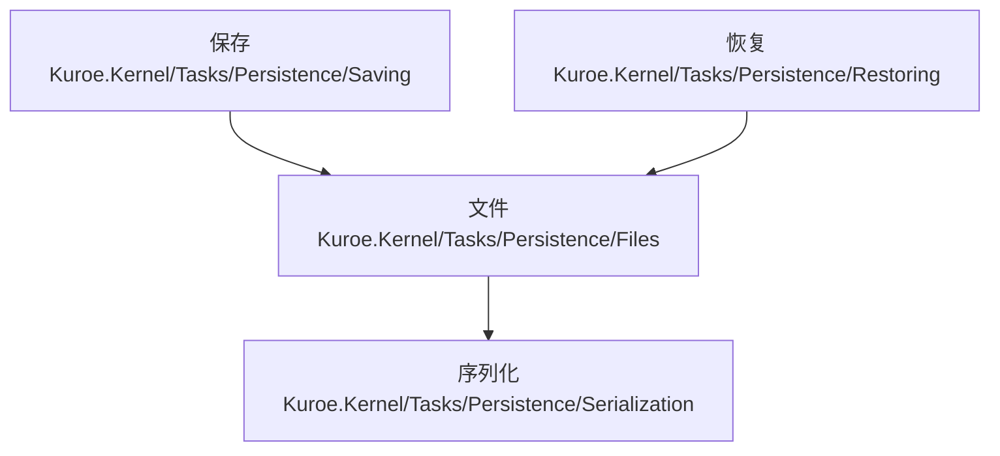

# 任务存档

上层结构见[内核](../index.md)。

| 子域 | 项目 | 文件 |
| --- | --- | --- |
| 文件 | `Kuroe.Kernel.Tasks.Persistence.Files.Shared` | [kuroe-kernel-tasks-persistence-files-shared](kuroe-kernel-tasks-persistence-files-shared.md) |
| 文件 | `Kuroe.Kernel.Tasks.Persistence.Files` | [kuroe-kernel-tasks-persistence-files](kuroe-kernel-tasks-persistence-files.md) |
| 序列化 | `Kuroe.Kernel.Tasks.Persistence.Serialization.Shared` | [kuroe-kernel-tasks-persistence-serialization-shared](kuroe-kernel-tasks-persistence-serialization-shared.md) |
| 序列化 | `Kuroe.Kernel.Tasks.Persistence.Serialization.Json` | [kuroe-kernel-tasks-persistence-serialization-json](kuroe-kernel-tasks-persistence-serialization-json.md) |
| 保存 | `Kuroe.Kernel.Tasks.Persistence.Saving.Shared` | [kuroe-kernel-tasks-persistence-saving-shared](kuroe-kernel-tasks-persistence-saving-shared.md) |
| 保存 | `Kuroe.Kernel.Tasks.Persistence.Saving` | [kuroe-kernel-tasks-persistence-saving](kuroe-kernel-tasks-persistence-saving.md) |
| 恢复 | `Kuroe.Kernel.Tasks.Persistence.Restoring.Shared` | [kuroe-kernel-tasks-persistence-restoring-shared](kuroe-kernel-tasks-persistence-restoring-shared.md) |
| 恢复 | `Kuroe.Kernel.Tasks.Persistence.Restoring` | [kuroe-kernel-tasks-persistence-restoring](kuroe-kernel-tasks-persistence-restoring.md) |