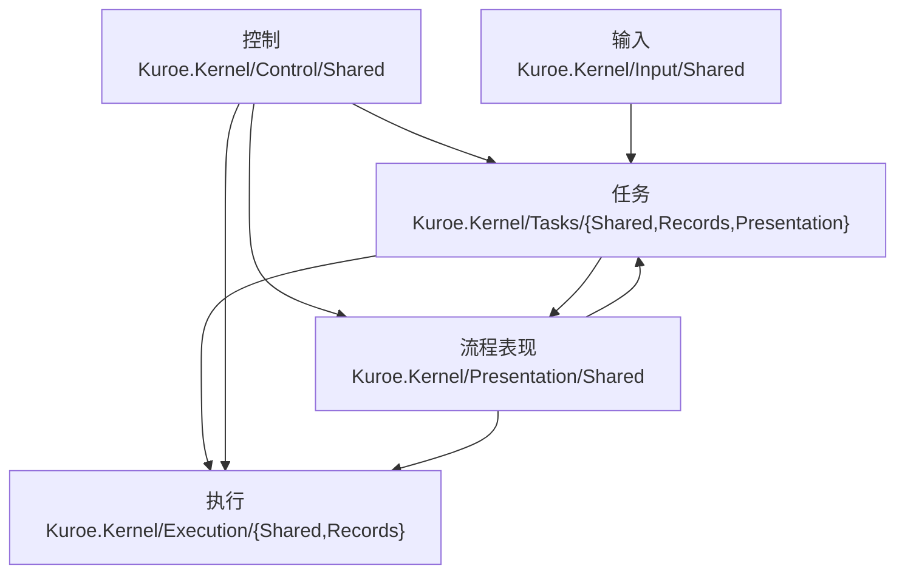

# 契约

上层结构见[内核](../index.md)。

| 子域 | 项目 | 文件 |
| --- | --- | --- |
| 任务 | `Kuroe.Kernel.Tasks.Shared` | [kuroe-kernel-tasks-shared](kuroe-kernel-tasks-shared.md) |
| 任务 | `Kuroe.Kernel.Tasks.Records.Shared` | [kuroe-kernel-tasks-records-shared](kuroe-kernel-tasks-records-shared.md) |
| 任务 | `Kuroe.Kernel.Tasks.Presentation.Shared` | [kuroe-kernel-tasks-presentation-shared](kuroe-kernel-tasks-presentation-shared.md) |
| 执行 | `Kuroe.Kernel.Execution.Shared` | [kuroe-kernel-execution-shared](kuroe-kernel-execution-shared.md) |
| 执行 | `Kuroe.Kernel.Execution.Records.Shared` | [kuroe-kernel-execution-records-shared](kuroe-kernel-execution-records-shared.md) |
| 控制 | `Kuroe.Kernel.Control.Shared` | [kuroe-kernel-control-shared](kuroe-kernel-control-shared.md) |
| 输入 | `Kuroe.Kernel.Input.Shared` | [kuroe-kernel-input-shared](kuroe-kernel-input-shared.md) |
| 流程表现 | `Kuroe.Kernel.Presentation.Shared` | [kuroe-kernel-presentation-shared](kuroe-kernel-presentation-shared.md) |