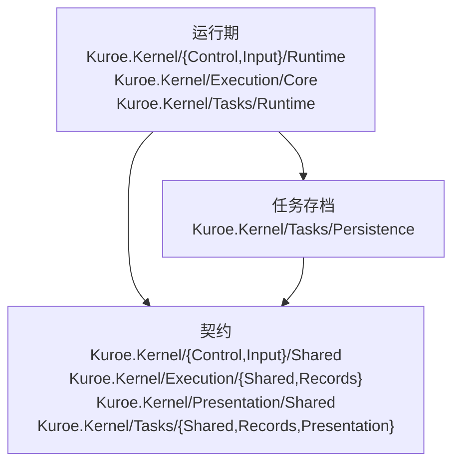

# 内核

上层结构见[项目结构](../index.md)。

| 子域 | 项目 | 文件 |
| --- | --- | --- |
| 运行期 | `Kuroe.Kernel.Execution` | [kuroe-kernel-execution](runtime/kuroe-kernel-execution.md) |
| 运行期 | `Kuroe.Kernel.Control.Runtime` | [kuroe-kernel-control-runtime](runtime/kuroe-kernel-control-runtime.md) |
| 运行期 | `Kuroe.Kernel.Input.Runtime` | [kuroe-kernel-input-runtime](runtime/kuroe-kernel-input-runtime.md) |
| 运行期 | `Kuroe.Kernel.Tasks.Runtime` | [kuroe-kernel-tasks-runtime](runtime/kuroe-kernel-tasks-runtime.md) |
| 任务存档 |  | [archive](archive/index.md) |
| 契约 |  | [contracts](contracts/index.md) |