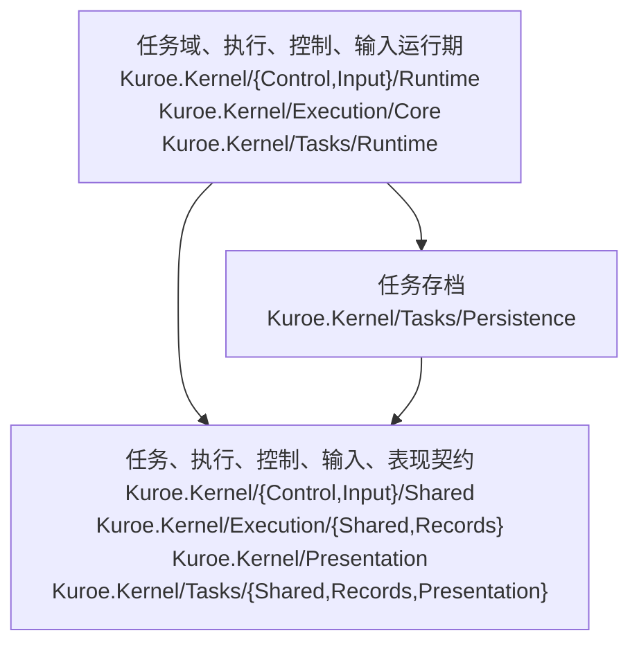

# 内核

上层结构见[项目结构](../index.md)。

| 项目 | 节点 | 边界文档 |
| --- | --- | --- |
| `Kuroe.Kernel.Execution` | 任务域、执行、控制、输入运行期 | [kuroe-kernel-execution](runtime/kuroe-kernel-execution.md) |
| `Kuroe.Kernel.Control.Runtime` | 任务域、执行、控制、输入运行期 | [kuroe-kernel-control-runtime](runtime/kuroe-kernel-control-runtime.md) |
| `Kuroe.Kernel.Input.Runtime` | 任务域、执行、控制、输入运行期 | [kuroe-kernel-input-runtime](runtime/kuroe-kernel-input-runtime.md) |
| `Kuroe.Kernel.Tasks.Runtime` | 任务域、执行、控制、输入运行期 | [kuroe-kernel-tasks-runtime](runtime/kuroe-kernel-tasks-runtime.md) |
| `Kuroe.Kernel.Tasks.Persistence.Files.Shared` | 任务存档 | [kuroe-kernel-tasks-persistence-files-shared](archive/kuroe-kernel-tasks-persistence-files-shared.md) |
| `Kuroe.Kernel.Tasks.Persistence.Files` | 任务存档 | [kuroe-kernel-tasks-persistence-files](archive/kuroe-kernel-tasks-persistence-files.md) |
| `Kuroe.Kernel.Tasks.Persistence.Saving.Shared` | 任务存档 | [kuroe-kernel-tasks-persistence-saving-shared](archive/kuroe-kernel-tasks-persistence-saving-shared.md) |
| `Kuroe.Kernel.Tasks.Persistence.Saving` | 任务存档 | [kuroe-kernel-tasks-persistence-saving](archive/kuroe-kernel-tasks-persistence-saving.md) |
| `Kuroe.Kernel.Tasks.Persistence.Restoring.Shared` | 任务存档 | [kuroe-kernel-tasks-persistence-restoring-shared](archive/kuroe-kernel-tasks-persistence-restoring-shared.md) |
| `Kuroe.Kernel.Tasks.Persistence.Restoring` | 任务存档 | [kuroe-kernel-tasks-persistence-restoring](archive/kuroe-kernel-tasks-persistence-restoring.md) |
| `Kuroe.Kernel.Tasks.Persistence.Serialization.Shared` | 任务存档 | [kuroe-kernel-tasks-persistence-serialization-shared](archive/kuroe-kernel-tasks-persistence-serialization-shared.md) |
| `Kuroe.Kernel.Tasks.Persistence.Serialization.Json` | 任务存档 | [kuroe-kernel-tasks-persistence-serialization-json](archive/kuroe-kernel-tasks-persistence-serialization-json.md) |
| `Kuroe.Kernel.Execution.Shared` | 任务、执行、控制、输入、表现契约 | [kuroe-kernel-execution-shared](contracts/kuroe-kernel-execution-shared.md) |
| `Kuroe.Kernel.Execution.Records.Shared` | 任务、执行、控制、输入、表现契约 | [kuroe-kernel-execution-records-shared](contracts/kuroe-kernel-execution-records-shared.md) |
| `Kuroe.Kernel.Control.Shared` | 任务、执行、控制、输入、表现契约 | [kuroe-kernel-control-shared](contracts/kuroe-kernel-control-shared.md) |
| `Kuroe.Kernel.Input.Shared` | 任务、执行、控制、输入、表现契约 | [kuroe-kernel-input-shared](contracts/kuroe-kernel-input-shared.md) |
| `Kuroe.Kernel.Presentation.Shared` | 任务、执行、控制、输入、表现契约 | [kuroe-kernel-presentation-shared](contracts/kuroe-kernel-presentation-shared.md) |
| `Kuroe.Kernel.Tasks.Shared` | 任务、执行、控制、输入、表现契约 | [kuroe-kernel-tasks-shared](contracts/kuroe-kernel-tasks-shared.md) |
| `Kuroe.Kernel.Tasks.Records.Shared` | 任务、执行、控制、输入、表现契约 | [kuroe-kernel-tasks-records-shared](contracts/kuroe-kernel-tasks-records-shared.md) |
| `Kuroe.Kernel.Tasks.Presentation.Shared` | 任务、执行、控制、输入、表现契约 | [kuroe-kernel-tasks-presentation-shared](contracts/kuroe-kernel-tasks-presentation-shared.md) |