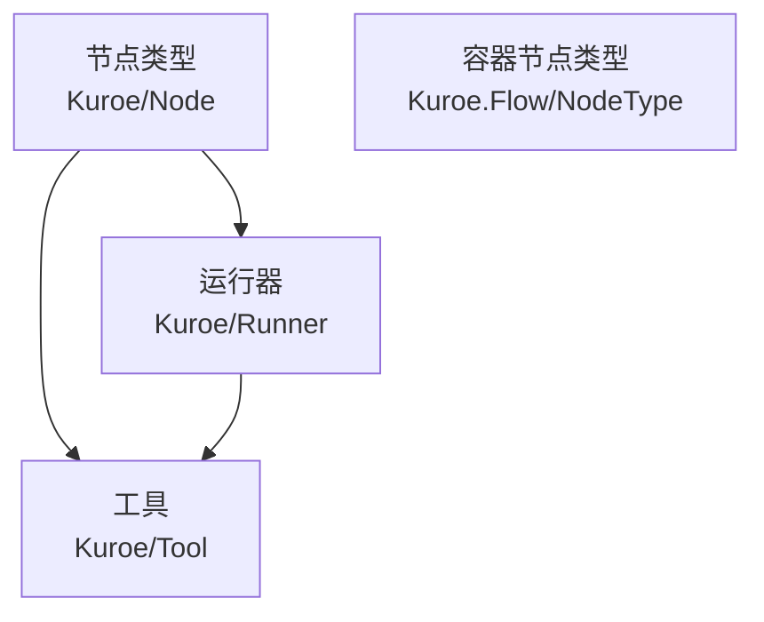

# 执行能力

上层结构见[项目结构](../index.md)。

| 项目 | 节点 | 边界文档 |
| --- | --- | --- |
| `Kuroe.Node.Llm` | 节点类型 | [kuroe-node-llm](node/kuroe-node-llm.md) |
| `Kuroe.Node.Command` | 节点类型 | [kuroe-node-command](node/kuroe-node-command.md) |
| `Kuroe.Node.File` | 节点类型 | [kuroe-node-file](node/kuroe-node-file.md) |
| `Kuroe.Node.Input` | 节点类型 | [kuroe-node-input](node/kuroe-node-input.md) |
| `Kuroe.Node.Approval` | 节点类型 | [kuroe-node-approval](node/kuroe-node-approval.md) |
| `Kuroe.Runner.Shared` | 运行器 | [kuroe-runner-shared](runner/kuroe-runner-shared.md) |
| `Kuroe.Runner.Llm` | 运行器 | [kuroe-runner-llm](runner/kuroe-runner-llm.md) |
| `Kuroe.Runner.Command` | 运行器 | [kuroe-runner-command](runner/kuroe-runner-command.md) |
| `Kuroe.Runner.File` | 运行器 | [kuroe-runner-file](runner/kuroe-runner-file.md) |
| `Kuroe.Runner.Input` | 运行器 | [kuroe-runner-input](runner/kuroe-runner-input.md) |
| `Kuroe.Runner.Approval` | 运行器 | [kuroe-runner-approval](runner/kuroe-runner-approval.md) |
| `Kuroe.Tool` | 工具 | [kuroe-tool](tool/kuroe-tool.md) |
| `Kuroe.Tool.Json` | 工具 | [kuroe-tool-json](tool/kuroe-tool-json.md) |
| `Kuroe.Tool.FileAccess.Shared` | 工具 | [kuroe-tool-fileaccess-shared](tool/kuroe-tool-fileaccess-shared.md) |
| `Kuroe.Tool.FileAccess` | 工具 | [kuroe-tool-fileaccess](tool/kuroe-tool-fileaccess.md) |
| `Kuroe.Tool.Implementation.Command.Shared` | 工具 | [kuroe-tool-implementation-command-shared](tool/kuroe-tool-implementation-command-shared.md) |
| `Kuroe.Tool.Implementation.Command` | 工具 | [kuroe-tool-implementation-command](tool/kuroe-tool-implementation-command.md) |
| `Kuroe.Tool.Implementation.Command.Json` | 工具 | [kuroe-tool-implementation-command-json](tool/kuroe-tool-implementation-command-json.md) |
| `Kuroe.Tool.Implementation.Contract` | 工具 | [kuroe-tool-implementation-contract](tool/kuroe-tool-implementation-contract.md) |
| `Kuroe.Tool.Implementation.Dotnet` | 工具 | [kuroe-tool-implementation-dotnet](tool/kuroe-tool-implementation-dotnet.md) |
| `Kuroe.Tool.Implementation.File` | 工具 | [kuroe-tool-implementation-file](tool/kuroe-tool-implementation-file.md) |
| `Kuroe.Tool.Implementation.Git` | 工具 | [kuroe-tool-implementation-git](tool/kuroe-tool-implementation-git.md) |
| `Kuroe.Tool.Implementation.KuroeInfo` | 工具 | [kuroe-tool-implementation-kuroeinfo](tool/kuroe-tool-implementation-kuroeinfo.md) |
| `Kuroe.Tool.Implementation.Source` | 工具 | [kuroe-tool-implementation-source](tool/kuroe-tool-implementation-source.md) |
| `Kuroe.Tool.Implementation.Time` | 工具 | [kuroe-tool-implementation-time](tool/kuroe-tool-implementation-time.md) |
| `Kuroe.Flow.NodeType.Container` | 容器节点类型 | [kuroe-flow-nodetype-container](container/kuroe-flow-nodetype-container.md) |