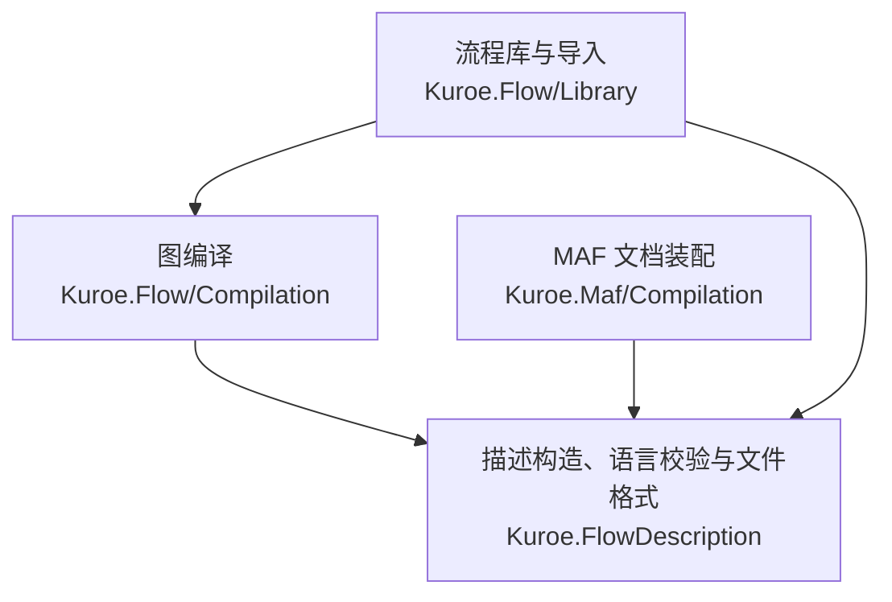

# 描述编译

上层结构见[项目结构](../index.md)。

| 项目 | 节点 | 边界文档 |
| --- | --- | --- |
| `Kuroe.FlowDescription.Description.Shared` | 描述构造、语言校验与文件格式 | [kuroe-flow-description-description-shared](flow-description/kuroe-flow-description-description-shared.md) |
| `Kuroe.FlowDescription.Definition.Shared` | 描述构造、语言校验与文件格式 | [kuroe-flow-description-definition-shared](flow-description/kuroe-flow-description-definition-shared.md) |
| `Kuroe.FlowDescription.Compilation.Shared` | 描述构造、语言校验与文件格式 | [kuroe-flow-description-compilation-shared](flow-description/kuroe-flow-description-compilation-shared.md) |
| `Kuroe.FlowDescription.Compilation` | 描述构造、语言校验与文件格式 | [kuroe-flow-description-compilation](flow-description/kuroe-flow-description-compilation.md) |
| `Kuroe.FlowDescription.Json.Shared` | 描述构造、语言校验与文件格式 | [kuroe-flow-description-json-shared](flow-description/kuroe-flow-description-json-shared.md) |
| `Kuroe.FlowDescription.Json` | 描述构造、语言校验与文件格式 | [kuroe-flow-description-json](flow-description/kuroe-flow-description-json.md) |
| `Kuroe.Flow.Compilation` | 图编译 | [kuroe-flow-compilation](compilation/kuroe-flow-compilation.md) |
| `Kuroe.Flow.Library` | 流程库与导入 | [kuroe-flow-library](library/kuroe-flow-library.md) |
| `Kuroe.Flow.Library.Files` | 流程库与导入 | [kuroe-flow-library-files](library/kuroe-flow-library-files.md) |
| `Kuroe.Maf.Compilation.Shared` | MAF 文档装配 | [kuroe-maf-compilation-shared](maf-compilation/kuroe-maf-compilation-shared.md) |
| `Kuroe.Maf.Compilation` | MAF 文档装配 | [kuroe-maf-compilation](maf-compilation/kuroe-maf-compilation.md) |