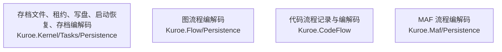

# 存档恢复

上层结构见[项目结构](../index.md)。

| 项目 | 节点 | 边界文档 |
| --- | --- | --- |
| `Kuroe.Kernel.Tasks.Persistence.Files.Shared` | 存档文件、租约、写盘、启动恢复、存档编解码 | [kuroe-kernel-tasks-persistence-files-shared](archive/kuroe-kernel-tasks-persistence-files-shared.md) |
| `Kuroe.Kernel.Tasks.Persistence.Files` | 存档文件、租约、写盘、启动恢复、存档编解码 | [kuroe-kernel-tasks-persistence-files](archive/kuroe-kernel-tasks-persistence-files.md) |
| `Kuroe.Kernel.Tasks.Persistence.Saving.Shared` | 存档文件、租约、写盘、启动恢复、存档编解码 | [kuroe-kernel-tasks-persistence-saving-shared](archive/kuroe-kernel-tasks-persistence-saving-shared.md) |
| `Kuroe.Kernel.Tasks.Persistence.Saving` | 存档文件、租约、写盘、启动恢复、存档编解码 | [kuroe-kernel-tasks-persistence-saving](archive/kuroe-kernel-tasks-persistence-saving.md) |
| `Kuroe.Kernel.Tasks.Persistence.Restoring.Shared` | 存档文件、租约、写盘、启动恢复、存档编解码 | [kuroe-kernel-tasks-persistence-restoring-shared](archive/kuroe-kernel-tasks-persistence-restoring-shared.md) |
| `Kuroe.Kernel.Tasks.Persistence.Restoring` | 存档文件、租约、写盘、启动恢复、存档编解码 | [kuroe-kernel-tasks-persistence-restoring](archive/kuroe-kernel-tasks-persistence-restoring.md) |
| `Kuroe.Kernel.Tasks.Persistence.Serialization.Shared` | 存档文件、租约、写盘、启动恢复、存档编解码 | [kuroe-kernel-tasks-persistence-serialization-shared](archive/kuroe-kernel-tasks-persistence-serialization-shared.md) |
| `Kuroe.Kernel.Tasks.Persistence.Serialization.Json` | 存档文件、租约、写盘、启动恢复、存档编解码 | [kuroe-kernel-tasks-persistence-serialization-json](archive/kuroe-kernel-tasks-persistence-serialization-json.md) |
| `Kuroe.Flow.Persistence.Serialization.Graph` | 图流程编解码 | [kuroe-flow-persistence-serialization-graph](graph-codec/kuroe-flow-persistence-serialization-graph.md) |
| `Kuroe.CodeFlow.Records.Shared` | 代码流程记录与编解码 | [kuroe-codeflow-records-shared](code-records/kuroe-codeflow-records-shared.md) |
| `Kuroe.CodeFlow.Persistence` | 代码流程记录与编解码 | [kuroe-codeflow-persistence](code-records/kuroe-codeflow-persistence.md) |
| `Kuroe.Maf.Persistence` | MAF 流程编解码 | [kuroe-maf-persistence](maf-codec/kuroe-maf-persistence.md) |